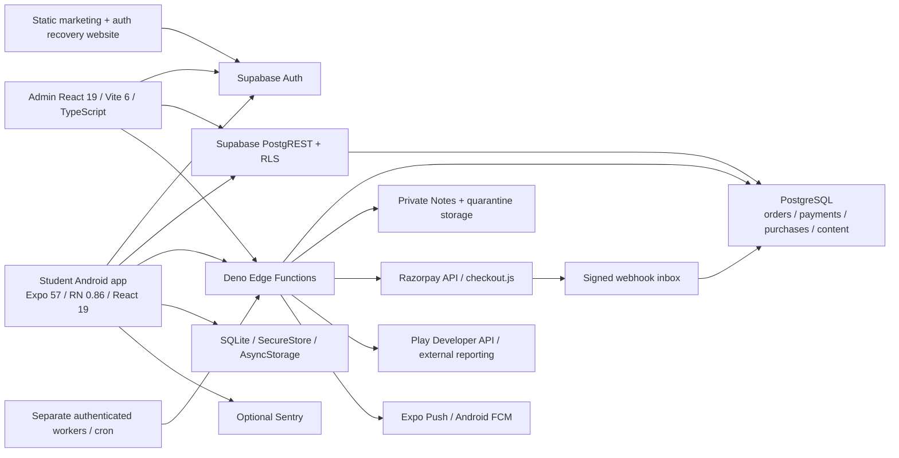

# COMPLETE PROJECT DEEP AUDIT

Audit date: 2026-11-11 UTC. Scope: current working tree, including pre-existing uncommitted changes. **Audit only; no deployment authorization.**

**Verdict: PRODUCTION NO-GO.** The repository contains a substantial functional application and strong synthetic payment/database regression coverage. It does not establish an accepted production release. No completion percentage is justified: screens, backend contracts and operational prerequisites have different weights, and managed/native/provider journeys remain unverified.

## Evidence and scope

The audit preserved the initial Git inventory and hashes before executing checks. See [initial status](evidence/initial-git-status.txt), [initial file hashes](evidence/initial-files.json), [recent history](evidence/git-history.txt), and [source inventory](evidence/source-inventory.json). The discovery index covers 510 source/schema/workflow files and 58,232 lines, including table and RPC references. There are 74 migration files. Dependency/generated directories were excluded from the source inventory; installed versions and lockfiles were inspected separately.

Tests ran in `/tmp/medveda-full-audit-snapshot`, with existing node_modules shared by symlink without dependency installation and no `.env` files copied. Generated builds and rehearsal output stayed in disposable paths or this new report directory. Existing audit artifacts were inputs, never overwritten. The initial tree already contained extensive mobile/backend fixes and untracked release candidates. HEAD alone does not identify this release.

This is a broad source and automated regression audit, with deeper manual tracing of authentication, payments, entitlement, migrations and admin operations. It is **not** exhaustive interactive execution of every screen/component, a penetration test, a device lab run or certification that no further bugs exist. A file appearing in the inventory means indexed, not every branch semantically verified. Unexecuted UI, hosted Auth/Storage and genuine provider/native behavior remain explicitly unverified.

## Discovered architecture

The principal consumer UI is `mobile-app`, with a web target; `admin-panel` is a separate browser application. `website` is a static generator, not a shopping web application. Root HTML and `github-original-website` are additional legacy/public surfaces and must not be confused with the generated website. Supabase supplies Auth, relational storage, RLS, service-only financial RPCs, private object storage, Edge Functions and scheduled work. There is no active Firebase payment backend in the audited application path. Comments mentioning Firestore are historical compatibility context.

## Functional conclusions

Locally exercised subsets include auth/recovery parsing and network handling, course selection/races, search pagination/cache, purchased ownership/account isolation, store loading/error behavior, checkout validation, signed verification, native PDF lifecycle mocks, offline owner boundaries, quiz state and synchronization, admin mutation/pagination helpers, PDF validation and financial SQL. See [feature inventory](FEATURE_COMPLETENESS_MATRIX.md) for boundaries.

Paid checkout is deliberately disabled in production Android profiles. Play billing choice requires enrollment, genuine tokens, SKU/offer consistency, server gates, authorized transaction reporting and actual native/provider acceptance. The marketing website has no implemented catalog-to-checkout UI. Support form submission opens the user's email app; it does not send mail itself. Large PDF upload depends on a separately operating validator worker. Push depends on genuine FCM configuration and device acceptance. Operational delivery of those dependencies is not established by source existence.

Confirmed defects include workspace acknowledgement of unresolved reversals, targeted notification disclosure, admin analytics truncation, unusable order-status menu choices, duplicate-import CI failures and an outdated test mock. The original C execution wrapper also contains two independently reproduced defects. Full details and reproduction evidence are in [security and bug report](SECURITY_AND_BUG_REPORT.md).

## Previous B-to-C rehearsal verification

Prior claims are retained as historical evidence in `MEDVEDA_B_TO_C_ATOMIC_REHEARSAL_2026-11-11.md`. This audit reproduced original hash mismatch and invalid FOREACH parsing; atomic A 66→69; corrected C 69→73; strong final proof and exact migration-source ledger records; all baseline function preimages; financial-row preservation on synthetic history; forced rollback after all four C stages; legacy B handler, recovery and history paths; candidate choice authorization/reporting; final-schema contracts and MV005/MV006 concurrency. See fresh logs and the detailed migration report.

Rehearsal scripts required only disposable host/path adaptation in the copied snapshot. An initial final Notes-choice concurrency invocation failed a hardcoded old-socket assertion after preceding scenarios had passed. That nonzero run is not a complete pass; the supplemental runs and final command ledger record what was subsequently reproduced. No approved release SQL or application source was changed to obtain a pass. Prior retained logs are not counted as fresh tests.

The corrected wrapper is technically reviewable, **not independently authorized for production**. It changes 126 definition comparisons to trim whitespace consistently and fixes two ARRAY expressions, preserving migration bodies. Original B is compatible with legacy post-C traffic but does not implement the complete new choice-reporting path. The four-function compatible closure is a separate release candidate; its source/archive identity must be delivered explicitly. Current workspace reversal behavior differs from that candidate.

## Production evidence and direct answers

See [readiness report](PRODUCTION_READINESS_GO_NO_GO.md) for all 20 requested answers and [fresh execution ledger](evidence/TEST_EXECUTION.md) for commands, exit codes and limitations. Read-only production observations are described there separately from local synthetic acceptance. No payment endpoint or financial worker was remotely invoked. No genuine payment, enrollment test, transaction report/refund, app publication or database migration was executed.

**Do not run blanket `supabase db push`.** The intended seven-migration sequence differs from timestamp order and excludes the isolated test installer. Recovery, approved candidate identity, production drift, ingress/worker quiescence, compatible Edge delivery and unknown-commit handling are mandatory release gates. A synthetic preservation result cannot guarantee safety of current production data or replace a demonstrated full restore.

## Fresh production observation supplement

[Read-only production evidence](evidence/production-readonly.json) confirms 66 versions through `20261104110000`, no `razorpay_entitlement_committed` RPC, deployed verify-payment v68 / webhook v50 / create-order v23, and seven bundle hashes. The verifier/webhook do not contain the reviewed commitment call. Two successful purchases are linked to non-paid orders and one duplicate-success ownership group exists. These records were neither exposed individually nor modified. This establishes deployment/data gaps, not genuine provider settlement acceptance.

The current `require_ucb_for_razorpay=false` setting is not a payment kill switch. Active wallet-credit cron must be considered in quiescence. Live credentials/account/webhook dashboard activation remain UNKNOWN; no real charge or worker invocation occurred.
